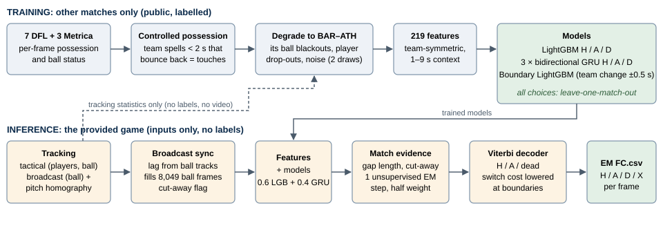

# EM FC: frame-level ball possession from automatic tracking

**More than a Hack 2027, Initial Challenge: FC Barcelona vs Athletic Club**

| | |
|---|---|
| Team | EM FC |
| Possession file | `EM FC.csv`: 199,319 rows, SHA-256 `9b029648d599dc6e310fdb2ba59c1f40ea6ac3631a5d84536a304ccaf1aba23d` |
| Code | The public repository submitted with this document. `python make_submission.py` regenerates the file byte for byte |
| Method | Gradient-boosted trees + bidirectional GRU, trained only on public tracking data from **other matches** and adapted to this match's tracking quality; label-free match evidence; Viterbi decoding into possession spells |
| Uses of the provided game | Tactical tracking, broadcast tracking and its pitch homography, as **inputs only**. No training, fitting or tuning on its ground truth or its video, no hand labels, no human-produced data about the game |

---

## 1. Summary

Each frame of the match is labelled `H` (Barcelona in possession), `A` (Athletic), `D` (ball dead)
or `X` (outside the two halves). The pipeline has four parts:

1. **Make the provided tracking as complete as the data allows** (section 4). The broadcast
   recording's tracking is synchronised to the tactical one, from the two ball tracks alone, and
   fills 8,049 missing ball frames. The broadcast also tells us when the director cuts away to a
   replay or a close-up.
2. **Learn possession on other matches** (sections 3 and 5). Matches from two public datasets have
   per-frame possession and ball-status labels. Their clean tracking is **degraded to look like this
   match's automatic tracking**: the same ball blackouts, the same player drop-outs, realistic
   noise. Then a frame model (LightGBM + bidirectional GRU) is trained on them, on 219
   team-symmetric features.
3. **Add evidence from this match without labels** (section 6). How strongly a ball blackout or a
   broadcast cut-away signals a stoppage is tracker- and broadcaster-specific. It is estimated on
   this match by one unsupervised EM step against the model's own predictions.
4. **Decode possession spells** (section 7). A Viterbi decoder turns per-frame probabilities into
   spells, paying a cost for every change of possession and every stoppage. A separately learned possession-boundary model makes a switch cheaper exactly where a real change of control is likely.



Every choice, from features and model settings to blend weights and decoder costs, was made on
**leave-one-match-out** validation over 10 external matches. The provided game's 5 public minutes
were scored **once**, at the end, as a pipeline check only.

| check | spellF1 | macroF1 |
|---|---|---|
| 10 external matches, each held out in turn (choice made on all 10) | 0.715 | 0.885 |
| same, nested (choices made on 9, scored on the 10th) | 0.713 | |
| 20 further external matches, never trained on or tuned with (team-only labels) | 0.566 | |
| provided game, public 5 minutes, scored once after freezing | 0.653 | 0.833 |

---

## 2. Possession rules implemented

The challenge defines possession as control: a touch without control, or a deflection that does
not intercept the pass, does not change it. Our rules follow that definition, and the learned model
inherits them from the training labels (section 3).

| situation | rule |
|---|---|
| **Change of possession** | Only on **control**. In the training labels, a team spell shorter than **2 s** that ends with the previous team back on the ball, or with play stopping, is a touch, not a possession, and is given back to the previous team (`possession/ml/labels.py`). 2 s is "a player keeps the ball for a few seconds" at its shortest. It was fixed before any experiment |
| **Loose ball, ball in flight** | Stays with the last team in control until the other team gains control. In the decoder, every switch has a cost, so a switch needs sustained evidence |
| **Challenges, 50/50s, deflections** | Possession does not change unless the other team then keeps the ball. A contested moment is a short burst of evidence that cannot pay the switch cost on its own. Where the boundary model sees a real change of control (section 5.4), the switch is cheaper, so genuine turnovers are kept and placed precisely |
| **Dead ball** | From the moment play stops (ball out, or a whistle that stops play) until the restart touch. Learned from ball-status labels in the training data, helped by the match evidence (blackouts, broadcast cut-aways) |
| **Restarts** | The restart belongs to the team that takes it. The decoder leaves `D` into whichever team then has the evidence |
| **Before the second-half kick-off** | The second half is graded from frame 110,808 but kicks off at 113,742 (organisers' FAQ). Those frames are `D` |
| **Outside the halves** | `X` |
| **Missing ball** | No frame is left unlabelled. The model predicts from team shape, player speeds and the time since and until the ball was seen. The decoder carries possession through a gap unless the evidence says the ball went dead |

---

## 3. Training data

All training and tuning data come from **other matches**. Nothing was labelled by us.

| dataset | licence | matches used | labels: what and by whom | amount (graded) | role |
|---|---|---|---|---|---|
| **DFL / IDSSE open data** (Bassek, Rein, Weber & Memmert 2025, *Scientific Data*; Bundesliga 1 and 2) | CC BY 4.0 | 7 | Per-frame `BallStatus` (alive/dead) and `BallPossession` (team), from the official league data collected by the league's data provider (Sportec Solutions) | 11.1 h, 44.8% dead | training and leave-one-match-out validation |
| **Metrica Sports sample data**, games 1–3 | Metrica sample-data terms (public) | 3 | Team in possession derived **by our code** from Metrica's public event data (who has the ball between events); dead ball where the event data has the ball out of play (`possession/external.py`) | 4.7 h, 45.1% dead | training and leave-one-match-out validation |
| **SkillCorner open data** (A-League 2024/25) | MIT | 20 | Per-frame team in possession from SkillCorner's possession phases; no dead-ball state | 17.8 h | **untouched check only**: never trained on, never used to choose anything |

Each source is pinned (revision or commit, and file sizes or SHA-256) in
`possession/ml/external_manifest.json` and `possession/external.py`.
Each source is downloaded into the git-ignored `data/external/` and is not redistributed.

**Why these sources.** DFL's ball status is the closest public match to the challenge's
definition of a dead ball. Metrica's tracking comes from the same kind of automatic tracker as the
provided game, and keeps its own real ball gaps. SkillCorner is broadcast-based tracking from yet
another provider, so it is a stress test of how well the model transfers.

---

## 4. Inputs from the provided game

| input | used for |
|---|---|
| Tactical tracking (players, ball, metadata) | Everything: features and model input |
| Broadcast tracking + pitch homography | Ball gap-fill and the cut-away flag (below) |
| Organisers' half boundaries (`games.py`, FAQ) | Graded frames, the second-half pre-kick-off stretch |
| Tactical and broadcast **video**, audio | **Not read** by the pipeline |
| Smart Tagging | **Not used** (section 9) |
| Public 5-minute ground truth | Scored once at the end. It is never an input and never selects anything |

### 4.1 Tracking clean-up (`possession/ml/sources.py`, `possession/data.py`)

- **Goalkeeper slots carry the wrong team at times.** The tracker's two keeper slots follow
  whichever keeper they re-acquire. One of them stands in the opposing penalty area for thousands
  of frames. Each keeper slot therefore takes, frame by frame, the team that defends the goal in its
  half of the pitch, which the attack directions in the metadata give.
- **Units.** Player speeds in the file are m/s, despite the "kph" label. Our features compute
  speeds from positions anyway (centred difference over ±2 frames), the same way for every source.
- **Identity.** Slots are tracklets with identity switches. No feature uses player identity
  (section 5.2).

### 4.2 Broadcast synchronisation and ball gap-fill (`possession/ml/broadcast.py`)

The tactical ball is visible on only **59.3%** of graded frames. The gaps are long blackouts, not
flicker. The broadcast recording has its own automatic tracking and a per-frame pitch homography.

- **Synchronisation.** The broadcast is the live feed, so within a half it runs at a constant delay
  from the tactical recording. The delay that minimises the median distance between the two ball
  tracks is found coarse to fine: 1-s means over a wide range, then frame by frame. It comes out
  as **4,014 frames** (first half) and **26,920 frames** (second half). The median distance
  between the balls at that lag is **0.8 m**. No video pixels and no labels are used.
- **Gap-fill.** Where the tactical ball is missing, the broadcast's ball is used if two conditions
  hold: its pitch transform is valid, with reprojection error under 5 m, and the ball does not jump
  more than 3 m. This fills **8,049** frames and raises ball visibility from 59.3% to **64.4%**.
- **Cut-away flag.** Where the broadcast has no pitch transform at the aligned frame, the director
  is showing a replay, a close-up or the crowd. That mostly happens while the ball is dead. The
  flag feeds the match evidence (section 6).

---

## 5. The frame model

### 5.1 Making external tracking look like the provided game's (`possession/ml/degrade.py`)

A model trained on clean tracking learns to rely on a ball that is always visible and 22 players
always tracked. Neither holds here. So each DFL match is degraded with statistics measured on the
provided game's **tracking alone**:

- **Ball visibility.** Each DFL half takes a contiguous stretch of the provided game's own
  ball-visibility mask (after gap-fill), from a random offset. The mask is copied **independently
  of the external labels**. So the model cannot learn the tracker-specific shortcut "missing ball
  means dead ball"; that link is estimated separately, without labels (section 6).
- **Players.** Players are dropped to the provided game's per-frame count of tracked players per
  team, choosing whom to drop afresh every 10 s.
- **Noise.** A slowly varying 0.3 m position bias per player and 0.2 m ball noise. Typical
  optical-tracking error is a few decimetres; these sizes were fixed a priori.
- **Metrica**, the same kind of tracker as the provided game, keeps its own ball gaps and gets only
  the player drop-outs.

**Two draws.** Every DFL and Metrica match is degraded twice, with different random offsets and drop-out choices (seeds fixed per match). LightGBM trains on both copies, which doubles the variety of ball-gap and drop-out patterns it sees for each match.

### 5.2 Features (`possession/ml/features.py`)

There are 219 features per frame. All of them describe a team or the ball, never a player, so
tracklet identity switches cannot hurt them. Each team is described in its own attacking
direction:

- **Ball proximity.** Nearest and second-nearest player to the ball, and the number of players
  within 2, 5 and 10 m.
- **Team shape.** Centroid, spread, the most advanced and the deepest player.
- **Movement.** Mean speed, the share of players running and walking, velocity towards goal.
- **Ball state.** Ball speed, ball still, ball beyond a line, ball on a restart spot (corner,
  centre, near the touchline), time since and until the ball was last and next seen, and the
  length of the current gap.
- **Context.** 24 key features also get centred 1, 3 and 9 s means, and past and future 2 and 6 s
  means.

**Home/away symmetry.** Every team feature comes as a home/away pair, so swapping the teams is an
exact column permutation. Training uses both views. Prediction averages the model on the match and
on its swapped copy (with H and A exchanged back), so the model cannot favour a side.

### 5.3 Models (`possession/ml/model.py`, `possession/ml/gru.py`)

- **LightGBM**, multiclass H/A/D: trained on every 5th frame (5 fps), 300 rounds, learning rate
  0.05, 63 leaves, 100 samples per leaf minimum, 70% feature and row bagging. Deterministic mode,
  so retraining reproduces the model file byte for byte.
- **Bidirectional GRU**: 2 layers of width 64 on 5 fps sequences of 51 s, with robust-scaled
  inputs, trained for 10 epochs (Adam, learning rate 2·10⁻³). It sees the whole context in both
  directions, which helps where the ball is missing. It is trained with PyTorch. Inference is a
  plain-numpy re-implementation that matches PyTorch to within 4·10⁻⁷, so making the submission
  does not need PyTorch. Three GRUs that differ only in their random seed are trained, and their probabilities are averaged.
- **Blend.** 0.6 × LightGBM + 0.4 × the mean of the three GRUs.

### 5.4 Possession-boundary model

A second LightGBM model (binary, 200 rounds, same features, same home/away symmetry) predicts
whether a **direct change of team** in the controlled labels happens within ±0.5 s of the frame.

- **It fires at real turnovers.** On held-out matches its mean probability is about 0.19 on
  boundary frames, against 0.02 elsewhere.
- **The decoder uses it to make a team switch cheaper exactly there** (section 7). So short
  possessions are split where the change really happens instead of being merged into their
  neighbours, while switches elsewhere stay expensive.

---

## 6. Match evidence without labels

Some signals carry information about stoppages whose strength depends on this particular tracker
and broadcast. Learning that strength from other matches would transfer badly, and the provided
game's labels may not be used. So it is estimated **on this match, without labels**:

- **Signals.** Two categorical signals. The first is the length of the ball-tracking gap the frame sits in (ball seen, under 2 s, 2–5 s, 5–10 s, 10–30 s, over 30 s). The second is the broadcast cut-away flag.
- **One EM step.** The model's own dead-ball probability gives each category's expected count
  under dead and under live play. The log-ratio of the two shares is that category's evidence. It
  is added to the dead state's score at **half weight**, a value fixed a priori.
- **On this match** the estimates come out as follows:
  - ball seen −1.22;
  - gaps from +0.62 (under 2 s) to +2.52 (over 30 s);
  - broadcast cut-away +1.51, live picture −0.78.

**Tested on held-out data first.** The gap evidence was tested on the held-out external matches
before it was adopted:

- **Metrica**, whose gaps are real: +0.009 spellF1.
- **DFL**, whose gaps are copied independently of its labels: no effect, as expected, which makes
  it a null check.

The cut-away flag could not be tested this way, since no external match has a broadcast
feed. It is used because it is label-free and its estimated direction is the expected one.

---

## 7. Decoder

The decoder is Viterbi over the states H, A and dead (`possession/decode.py`). Each half is decoded
on its own.

- **Scores.** The log of the blended probabilities, plus the match evidence on the dead state.
- **Costs.** Switching team directly costs 12, reduced to 12 × (1 − 0.9 b) where b is the boundary model's probability, so down to 1.2 at a certain boundary. Stopping or restarting play
  costs 12.
- **Offline on purpose.** The whole half is known before any label is written, so a change is
  placed where the evidence changes, not where a causal filter would notice it. spellF1 punishes
  lag heavily.
- **Pre-kick-off.** Frames 110,808–113,741 are set to `D` afterwards.

**How the costs were chosen.** The decoder costs, the blend weight and the boundary weight were chosen together
on the 10 held-out matches. The nested estimate repeats every choice on 9 matches and scores the
10th, so it shows how much of the gain is selection noise.

---

## 8. Validation

There is no leaderboard, and tuning on the public 5 minutes is not allowed. Besides, 17
possessions is far too few to choose between versions: one possession moves spellF1 by about
0.06. So the protocol was fixed before modelling:

1. **Leave-one-match-out** over the 10 labelled external matches (7 DFL + 3 Metrica). Each held-out
   match is degraded and labelled exactly like training data. It is never seen by the model that
   predicts it.
2. **Nested** estimate of the same, for selection bias.
3. **SkillCorner**: 20 matches, untouched. They were scored once with the final model, as a
   transfer check.
4. **The provided game's public 5 minutes**: scored once, after everything was frozen.

### 8.1 Results on external matches (leave-one-match-out spellF1)

| model | spellF1 | nested | macroF1 |
|---|---|---|---|
| LightGBM + decoder | 0.700 | 0.700 | 0.879 |
| + gap evidence | 0.704 | | 0.881 |
| GRU alone + gap evidence | 0.681 | | 0.871 |
| 0.75 LightGBM + 0.25 GRU + gap evidence | 0.708 | 0.703 | 0.882 |
| + possession-boundary decoder | 0.712 | 0.712 | 0.883 |
| **+ LightGBM on two degradation draws, 3 GRU seeds (submitted)** | **0.715** | **0.713** | **0.885** |

**Per held-out match (final model).** DFL 0.73, 0.66, 0.73, 0.70, 0.72, 0.70, 0.72; Metrica 0.73, 0.73, 0.73.

**SkillCorner.** 20 untouched matches from another league and tracker give a mean spellF1 of
**0.566** (0.555 before the boundary decoder and the ensembling, so the gain holds on data that played no part in choosing it). SkillCorner has no dead-ball state, so every predicted stoppage counts against the
score. The number checks transfer; it is not comparable with the table above.

### 8.2 The provided game

| public 5 minutes (17 possessions), scored once | spellF1 [5–95% bootstrap] | macroF1 | D F1 | team accuracy (both alive) |
|---|---|---|---|---|
| **EM FC** | **0.653 [0.45, 0.83]** | **0.833** | 0.714 | 0.942 |
| organisers' baseline (`baseline_smooth125`) | 0.424 [0.27, 0.59] | 0.581 | 0.146 | 0.885 |

**Full match:** 266 possessions (Barcelona 128, Athletic 138), mean 13.8 s, median 8.0 s. 42.4% of graded frames are dead, and Barcelona holds 59.5% of live-ball time.

These automatic checks use only the provided data:

- **Dead-ball share.** 42.4% of graded frames are dead, close to the 44.8–45.1% in the external
  training data.
- **Possession count.** 266 possessions, within the range of the external matches: 267–315 in the
  DFL labels and 202–242 in Metrica's.

---

## 9. What we tried and dropped

| idea | outcome |
|---|---|
| **A hand-built evidence model**: nearest-player control, outfield activity, ball-out and restart-spot rules, referee whistle from the audio, shirt colour at the ball from the video, Smart Tagging priors; its weights were set by hand | **Replaced.** Its weights could not be set on external data without hand tuning, and its best version fitted on external data reached only 0.56 spellF1 held out. The learned model reaches 0.715 |
| Whistle detection from the audio | Dropped with the hand-built model. It would need its threshold tuned on the provided game |
| Shirt colour from the video | Dropped: the learned model does without it, and the pipeline then needs no video at all |
| Smart Tagging (automatic phase tags) | Not used. Its phases are not possessions, and the learned model does without |
| A minimum stoppage length in the decoder (1 s) | No gain on held-out matches |
| Ball-out evidence: a ball tracked beyond a line, and the tracking gap that follows it, as extra EM categories | +0.0006 held out, no measurable gain: dropped |
| Second degradation draw without extra GRU seeds | No gain (0.712, nested 0.706): only adopted together with the GRU seeds |

---

## 10. Limitations

- **The external labels are proxies.**
  - DFL's ball status is close to the challenge's definition, but its possession flag follows
    every touch. The 2-s control rule maps it to controlled possession, but the rule is a reasoned
    default, not a measured one.
  - Metrica's possession is derived from events.
- **Short possessions.** On the public window 13 possessions are predicted against 17, so some short possessions are still merged into their neighbours. On the external matches the model predicts 5–15% fewer possessions than the DFL labels contain and more than Metrica's event-derived labels, so part of this is label convention.
- **Some sizes cannot be measured here.** The degrader's noise sizes and the cut-away weight
  cannot be checked without the provided game's labels.
- **Stoppages with the ball in view.** When play stops but the ball stays tracked and players keep
  moving (a quick free kick, an injury stoppage near the ball), the model relies on the slowdown
  and on ball position, and can be late.

**With more time:**
- more labelled matches, especially tracking where the ball stays visible through stoppages;
- a model of each team's controlling player rather than team aggregates;
- a learned duration model for possessions (a semi-Markov decoder).

---

## 11. Reproduction

```bash
pip install -r requirements.txt        # numpy, pandas, scipy, lightgbm (Linux: apt install libgomp1)
# put the challenge data bundle in ./data (or set MTAH_DATA_DIR)
python make_submission.py --name "EM FC"
python evaluation/validate_submission.py "evaluation/results/EM FC.csv"
```

- **Inputs read:** `data/tactical/` and `data/broadcast/` (tracking and homography; no mp4 is
  read).
- **Run time:** under a minute on a laptop CPU.
- **Determinism:** the output is byte-identical on Windows (Python 3.11) and Linux (Python 3.12),
  starting from empty caches.
- **Models:** the trained models are committed in `possession/ml/`. Retraining them from the public
  external data is `tools/train_v9.py` + `tools/exp_v10.py` (commands in `README.md`). Retraining
  reproduces the committed LightGBM files exactly.

---

## 12. References and credits

- Bassek, M., Rein, R., Weber, H., & Memmert, D. (2025). An integrated dataset of spatiotemporal
  and event data in elite soccer. *Scientific Data*. DFL / IDSSE open data, CC BY 4.0.
- Metrica Sports sample data, https://github.com/metrica-sports/sample-data
- SkillCorner open data, https://github.com/SkillCorner/opendata (MIT)
- Ke, G., et al. (2017). LightGBM: a highly efficient gradient boosting decision tree. *NeurIPS*.
- Cho, K., et al. (2014). Learning phrase representations using RNN encoder–decoder (GRU). *EMNLP*.
- Viterbi, A. (1967). Error bounds for convolutional codes. *IEEE Trans. Information Theory*.
- Dempster, A., Laird, N., & Rubin, D. (1977). Maximum likelihood from incomplete data via the EM
  algorithm. *JRSS B*.
